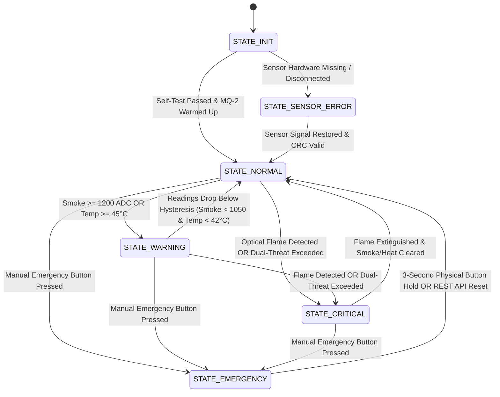
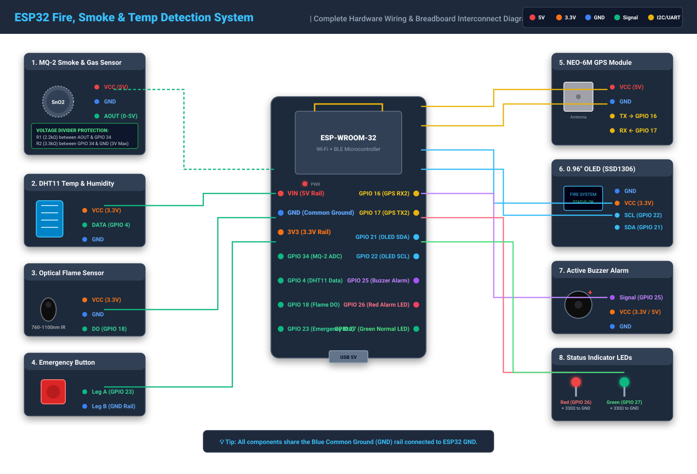
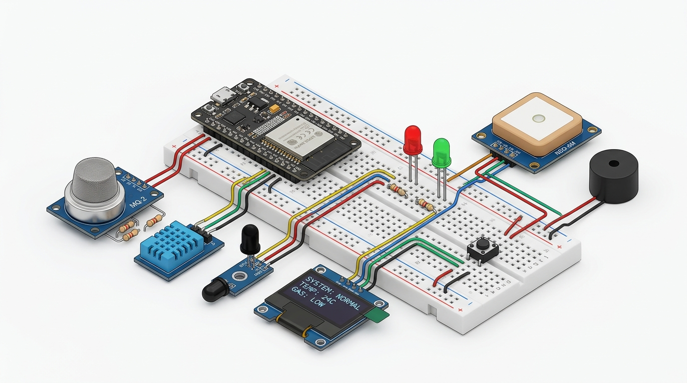
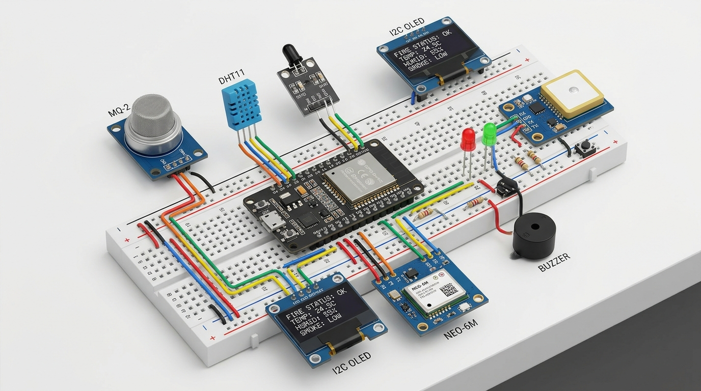

# IoT-Based Smart Fire, Smoke and Temperature Detection & Alert System

[](https://www.espressif.com/)
[](https://platformio.org/)
[](LICENSE)
[](docs/testing.md)

An engineering-grade, sensor-based Internet of Things (IoT) multi-threat fire detection, local alarm, and emergency telemetry dispatch system powered by the **ESP32** microcontroller.

> [!IMPORTANT]
> **ACADEMIC & PROTOTYPE DISCLAIMER:** This system is an engineering prototype designed for academic demonstrations, technical evaluations, and research into sensor fusion algorithms. It is strictly non-vision based (no cameras or computer vision) and is **not certified under UL 217, EN 54, or NFPA fire alarm standards**. It should not be used as the sole life-safety apparatus in commercial or residential buildings.

---

## 1. Project Overview & Problem Statement

Conventional fire alarm systems in residential and commercial facilities typically rely on single-parameter threshold detectors (such as simple ionization smoke detectors or bimetallic heat sensors). These legacy units suffer from two major flaws:
1. **High False-Alarm Rates:** Nuisance alarms triggered by cooking fumes, dust, or localized humidity spikes lead occupants to disable alarms, causing severe safety risks.
2. **Lack of Remote Telemetry & Geolocation:** Traditional alarms only buzz locally. If a structure is unoccupied or off-site responders need to be notified, legacy alarms fail to transmit real-time telemetry or precise incident geolocation.

### Objectives
* **Multi-Sensor Fusion:** Correlate optical infrared flame radiation, gas/smoke concentrations (MQ-2), and ambient temperature/humidity (DHT11) to eliminate false alarms while guaranteeing rapid response.
* **Deterministic Life-Safety Prioritization:** Optical flame detection or manual emergency activation immediately overrides all baseline readings to trigger instant local alarms and remote alerts.
* **Network & Satellite Independence:** Local alarms (active buzzer, warning LEDs, OLED display) operate with 100% autonomy without requiring Wi-Fi or satellite connectivity.
* **Remote Telemetry & Cloud Dispatch:** Dispatches rate-limited Telegram Bot notifications with GPS coordinates and provides an interactive web monitoring dashboard.

---

## 2. Key Features

* **Strictly Physical Sensor-Based:** Zero reliance on cameras, OpenCV, computer vision, or image processing.
* **Silicon-Aware Pin Mapping:** Dedicated use of **ADC1 (GPIO 34)** for the MQ-2 sensor to avoid the known ESP32 Wi-Fi / ADC2 silicon conflict.
* **Electrical Conditioning:** Precision 2.2kΩ / 3.3kΩ voltage divider stepping down 5.0V sensor signals to safe 3.0V levels for ESP32 ADC protection.
* **Non-Blocking Cooperative Scheduler:** Zero `delay()` calls in the main event loop; time-sliced `millis()` scheduling with an 8-second hardware Task Watchdog Timer (TWDT).
* **Anti-Flapping Hysteresis Engine:** Dual-threshold mathematical hysteresis for smoke ($\Delta = 150\text{ ADC}$) and temperature ($\Delta = 3.0^\circ\text{C}$) to prevent boundary oscillations.
* **Break-Glass Emergency Latching:** Manual push-button trigger latches the emergency state until explicitly disarmed via a 3-second long press or secure API call.
* **Multi-Page OLED UI:** 0.96" SSD1306 display auto-cycling between Environmental Monitoring and System Connectivity, with high-urgency flashing emergency takeover screens.
* **NEO-6M GPS Engine:** Continuous NMEA UART ingestion, strict 3D satellite fix validation, and dynamic Google Maps URL generation (with fail-safe indoor reporting).
* **Telegram Bot Dispatcher:** Encrypted HTTPS TLS alert dispatch with rate-limiting cooldowns (30s critical, 120s warning) and automatic recovery notifications.
* **Industrial Web Dashboard:** Responsive HTML5/CSS3/JavaScript dashboard with Chart.js real-time rolling telemetry graphs, dark/light theme, and REST API.

---

## 3. Hardware Architecture & Bill of Materials

| Component | Part / Module | Interface | Operating Rail | Function in System |
|---|---|---|---|---|
| Main Controller | ESP32 DevKit V1 (30-pin) | CPU / Wi-Fi | 3.3V (via LDO) | Core processing, state machine, HTTP REST API, Telegram client |
| Smoke & Gas Sensor | MQ-2 Semiconductor Sensor | ADC1 (GPIO 34) | 5.0V (VIN) | Combustible gas & smoke detection (sampled via voltage divider) |
| Temp & Humidity | DHT11 Digital Sensor | 1-Wire (GPIO 4) | 3.3V | Ambient temperature & relative humidity tracking |
| Optical Flame Sensor | IR Photodiode + LM393 | Digital (GPIO 18) | 3.3V | Optical flame radiation detection (760nm–1100nm, Active LOW) |
| Geolocation Module | u-blox NEO-6M GPS | UART2 (GPIO 16/17)| 5.0V (VIN) | NMEA satellite location tracking & atomic clock synchronization |
| Visual Display | 0.96" SSD1306 OLED | I2C (GPIO 21/22) | 3.3V | Local telemetry screen, multi-page metrics, and emergency takeover |
| Audible Siren | Active Buzzer (5V / 3.3V) | GPIO 25 | 3.3V / 5.0V | Distinct cadence audio alarm (warning chirp vs evacuation siren) |
| Status Indicators | Red & Green 5mm LEDs | GPIO 26 & 27 | 3.3V (via 330Ω) | Normal (Green ON) and Warning/Critical (Red Strobe) indicators |
| Manual Override | Tactile Push Button | GPIO 23 | 3.3V (Pull-up) | Manual emergency activation (Active LOW, 50ms debounced) |
| Resistors | 220Ω / 330Ω, 2.2kΩ, 3.3kΩ| Passive | — | Current limiting for LEDs and 5V $\to$ 3V voltage divider for MQ-2 |

---

## 4. Hardware Pinout & Wiring Connections

```
                             +----------------------------------------+
                             |              ESP32 DEVKIT              |
                             |                                        |
  [5V USB Rail] <----------- VIN                                      |
  [Common GND]  <----------- GND                                      |
                             |                                        |
                             | GPIO 34 (ADC1_CH6) <--- [2.2k / 3.3k Divider] <--- MQ-2 AOUT (5V)
                             | GPIO 4  (DHT11)    <--- DHT11 Data (3.3V)
                             | GPIO 18 (Flame DO) <--- Flame Sensor DO (3.3V)
                             | GPIO 16 (RX2)      <--- NEO-6M GPS TX
                             | GPIO 17 (TX2)      ---> NEO-6M GPS RX
                             | GPIO 21 (SDA)     <---> OLED SSD1306 SDA
                             | GPIO 22 (SCL)      ---> OLED SSD1306 SCL
                             | GPIO 25 (Buzzer)   ---> Active Buzzer Signal (I/O)
                             | GPIO 26 (Red LED)  ---> [330Ω] ---> Red LED Anode ---> GND
                             | GPIO 27 (Grn LED)  ---> [330Ω] ---> Green LED Anode -> GND
                             | GPIO 23 (Emerg Btn)<--- [Push Button] ---> GND
                             +----------------------------------------+
```

> [!CAUTION]
> **MQ-2 Heating Coil Power:** Connect MQ-2 `VCC` directly to the `VIN / 5V` rail from your USB power source. Never power the MQ-2 heater from the ESP32 `3V3` pin, as its 180 mA draw will overheat the onboard 3.3V regulator and cause brownout resets.

---

## 5. System Architecture & Detection State Machine



### Threat Decision Hierarchy
1. **Priority 1 (`STATE_EMERGENCY`):** Physical push button pressed down. Immediate latched alarm.
2. **Priority 2 (`STATE_CRITICAL`):** Optical flame detected. Flame cannot be ignored even if smoke/temp are baseline.
3. **Priority 3 (`STATE_CRITICAL`):** Extreme smoke ($\ge 2200\text{ ADC}$) OR Dual Elevated (Smoke $\ge 1200\text{ ADC}$ AND Temp $\ge 45^\circ\text{C}$).
4. **Priority 4 (`STATE_WARNING`):** Smoke alone $\ge 1200\text{ ADC}$ OR Temp alone $\ge 45^\circ\text{C}$.
5. **Priority 5 (`STATE_SENSOR_ERROR`):** Sensor disconnected, open circuit, or CRC failure.
6. **Priority 6 (`STATE_NORMAL`):** All sensors clear and nominal.

---

## 6. Project Directory Structure

```
smart-fire-detection/
├── firmware/
│   ├── include/
│   │   ├── config.h                   # Pinouts, sample rates, thresholds, and hysteresis constants
│   │   ├── types.h                    # SystemState, ThreatReason, SensorReadings, SystemStatus
│   │   ├── system_manager.h           # Diagnostics, Task Watchdog Timer, boot banner
│   │   ├── sensors/
│   │   │   ├── mq2.h                  # 10-sample moving average filter, ADC bounds
│   │   │   ├── dht11.h                # Single-wire driver, CRC sanity checks
│   │   │   ├── flame.h                # Active-low reader, 2.5s hold persistence
│   │   │   └── gps.h                  # NMEA parser, 3D fix validation, Google Maps URL
│   │   ├── controllers/
│   │   │   ├── detection.h            # Multi-sensor threat evaluation rule engine
│   │   │   ├── alarm.h                # Non-blocking buzzer/LED cadences
│   │   │   └── emergency.h            # Push-button debouncing, latching & reset
│   │   ├── communication/
│   │   │   ├── wifi_manager.h         # Background auto-reconnection state machine
│   │   │   ├── telegram_manager.h     # HTTPS Telegram client with cooldown throttles
│   │   │   └── web_server.h           # Onboard Port 80 REST API & CORS engine
│   │   ├── display/
│   │   │   └── oled.h                 # Multi-page SSD1306 driver & emergency banner
│   │   └── secrets.example.h          # Safe credential template
│   ├── src/
│   │   ├── main.cpp                   # Main setup & cooperative scheduler loop
│   │   ├── controllers/
│   │   ├── sensors/
│   │   ├── communication/
│   │   └── display/
│   └── platformio.ini                 # PlatformIO project configuration
│
├── dashboard/
│   ├── index.html                     # Responsive 10-section monitoring interface
│   ├── css/
│   │   └── style.css                  # Dark/light theme, industrial badges, strobe animations
│   ├── js/
│   │   └── app.js                     # Chart.js time-series streams & REST poller
│   └── server.py                      # Lightweight Python communication backend & bridge
│
├── docs/
│   ├── architecture.md                # Layered design & scheduling specification
│   ├── hardware-connections.md        # Electrical analysis, pin table, voltage divider math
│   ├── detection-algorithm.md         # Truth table, hysteresis formulas, calibration
│   ├── testing.md                     # Comprehensive 11-scenario test specification
│   └── images/                        # Hardware photograph placeholders
│
├── tests/
│   ├── test_sensor_algorithms.py      # Filter math, voltage reconstruction, hysteresis tests
│   ├── test_detection_engine.py       # Threat hierarchy & priority assertions
│   ├── test_emergency_alarm.py        # Button debounce, latching, and reset tests
│   ├── test_gps_parser.py             # NMEA sentence parsing & indoor safety tests
│   ├── test_telegram_alerts.py        # Alert payload formatting & cooldown rate limits
│   ├── test_dashboard_backend.py      # Schema assertions & simulation triggers
│   └── test_end_to_end_integration.py # Master 11-scenario integration runner
│
├── .gitignore
├── LICENSE
└── README.md
```

---

## 7. Setup & Installation Guide

### Step 1: Clone Repository & Configure Credentials
```bash
git clone https://github.com/SubikshanS/iot-alert-system.git
cd iot-alert-system
```

Copy the credentials template:
```bash
cp firmware/include/secrets.example.h firmware/include/secrets.h
```

Edit `firmware/include/secrets.h` with your Wi-Fi network and Telegram Bot credentials:
```cpp
#define WIFI_SSID           "MyHomeWiFi"
#define WIFI_PASSWORD       "MySecurePassword"
#define TELEGRAM_BOT_TOKEN  "1234567890:ABCdefGhIJKlmNoPQRsTUVwxyZ"
#define TELEGRAM_CHAT_ID    "987654321"
```
*(Note: If left unconfigured, the system runs safely in offline simulation/mock logging mode).*

---

### Step 2: Firmware Compilation & Flashing

#### Option A: Using PlatformIO (VS Code / CLI)
```bash
cd firmware
pio run --target upload
pio device monitor --baud 115200
```

#### Option B: Using Arduino IDE
1. Open Arduino IDE (v2.x or later).
2. Go to **Preferences** and add the ESP32 board manager URL:
   `https://raw.githubusercontent.com/espressif/arduino-esp32/gh-pages/package_esp32_index.json`
3. Install **esp32 by Espressif Systems** via Board Manager.
4. Open the Library Manager and install:
   * `Adafruit SSD1306`
   * `Adafruit GFX Library`
   * `DHT sensor library` (by Adafruit)
   * `TinyGPSPlus` (by Mikal Hart)
   * `ArduinoJson` (v7.x by Benoit Blanchon)
5. Select Board: **ESP32 Dev Module** and Port: your USB COM port.
6. Compile and Upload.

---

### Step 3: Web Dashboard Setup
Run the lightweight communication backend on your laptop or computer:
```bash
python dashboard/server.py
```
Open your browser to:
```
http://localhost:8000
```
* **To monitor your physical ESP32:** Enter the ESP32 IP address displayed on the OLED display or Serial Monitor into the dashboard IP field and click **"Connect Node"**.
* **To demonstrate offline:** Click **"Use Simulation"** to interact with the bench test controls without requiring physical sensors.

---

## 8. Verification & Test Results

Run the automated integration test suite from the root directory:
```bash
python tests/test_end_to_end_integration.py
```
**Output:**
```text
======================================================================
  RUNNING COMPLETE 11-SCENARIO INTEGRATION TEST SUITE (SECTION 9)     
======================================================================
[PASS] TC-01: Normal Environmental Conditions verified (Green ON, Buzzer Silent)
[PASS] TC-02: Elevated Temperature & Hysteresis verified (Warning state retained)
[PASS] TC-03: Increased MQ-2 Smoke Readings verified (Advisory warning generated)
[PASS] TC-04: Optical Flame Sensor Activation verified (Immediate override & GPS link)
[PASS] TC-05: Dual-Threat Correlation verified (Elevated smoke + heat escalates to CRITICAL)
[PASS] TC-06: Manual Emergency Button Latching & Reset verified
[PASS] TC-07: GPS Unavailable verified (Local alarm fires; indoor message sent without fake data)
[PASS] TC-08: Wi-Fi Outage verified (Local audible & visual alarms operate independently)
[PASS] TC-09: Sensor Disconnection verified (STATE_SENSOR_ERROR without system crash)
[PASS] TC-10: Telegram Notification Failure Resilience verified (Bounded non-blocking timeout)
[PASS] TC-11: Recovery After Abnormal Conditions verified (Single recovery notification dispatched)
======================================================================
  ALL 11 INTEGRATION TEST SCENARIOS PASSED WITH ZERO FAILURES!        
======================================================================
```

---

## 9. System Limitations & Future Improvements

### Known Engineering Limitations
1. **MQ-2 Preheating Requirement:** The tin-dioxide heating element requires an initial warm-up period (~20s in prototype, 24–48 hours for laboratory ppm accuracy) before establishing stable baseline resistance.
2. **GPS Indoor Attenuation:** 1.575 GHz L1 satellite signals attenuate through concrete ceilings. While the system operates safely indoors and logs `"Indoor / No Lock"`, outdoor positioning requires a window or sky view.
3. **DHT11 Sampling Latency:** The physical capacitive humidity element requires a minimum of 1.0–2.0 seconds between bus transactions.

### Future Improvements
* **Cellular NB-IoT / GSM Fallback:** Add a SIM7000G module to dispatch SMS/telemetry when Wi-Fi access points lose mains power during an actual fire.
* **Over-The-Air (OTA) Updates:** Integrate ESP32 dual-partition OTA firmware upgrades over Wi-Fi.
* **Dedicated Enclosure & PCB Design:** Fabricate a custom two-layer PCB with thermal isolation slots separating the ESP32 Wi-Fi antenna and MQ-2 heating coil from the DHT11 temperature sensor.

---

## 10. Hardware Wiring Diagrams & Visuals

### A. Vector Pin-to-Pin Breadboard Schematic
The complete high-resolution vector schematic showing all 8 peripheral modules, exact GPIO pins, and the MQ-2 voltage divider:



### B. Physical 3D Breadboard Assembly Reference


| Full System Overview | Detailed Breadboard Wiring |
|:---:|:---:|
|  |  |

---

## 11. License

This project is licensed under the **MIT License** — see the [LICENSE](LICENSE) file for complete details.

