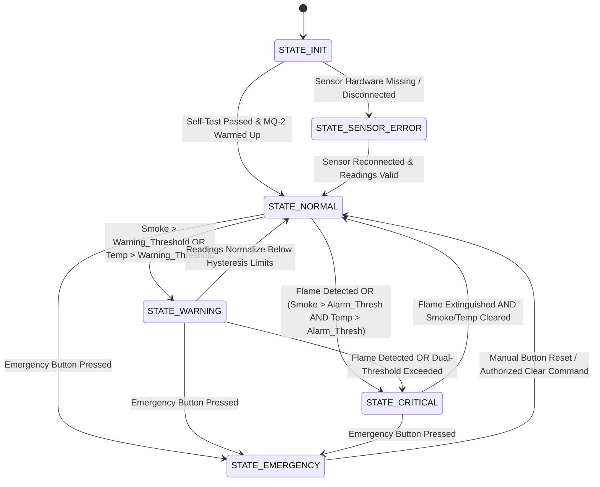

# System Architecture & Design Specification

## 1. High-Level Architecture Overview

The **IoT-Based Smart Fire, Smoke, and Temperature Detection & Alert System** is engineered as a modular, fault-tolerant embedded system. It decouples sensor acquisition, threat analysis, local safety actuation, and remote cloud telemetry to guarantee that life-critical functions (alarms, visual cues, local emergency response) operate reliably without depending on network availability or cloud server responsiveness.

### Architecture Layers

```
+-----------------------------------------------------------------------------------+
|                             LAYER 5: PRESENTATION                                 |
|   0.96" OLED Multi-Page Display   |   Web Dashboard (HTML5/CSS3/JS/Chart.js)      |
+-----------------------------------------------------------------------------------+
                                         ▲
                                         │
+-----------------------------------------------------------------------------------+
|                        LAYER 4: TELEMETRY & NOTIFICATIONS                         |
|   Telegram Bot Dispatcher (Rate-limited)   |   REST API / HTTP Web Server Engine  |
|   Wi-Fi Connection Manager (Non-blocking reconnect state machine)                 |
+-----------------------------------------------------------------------------------+
                                         ▲
                                         │
+-----------------------------------------------------------------------------------+
|                   LAYER 3: SENSOR FUSION & DECISION ENGINE                        |
|   Multi-Sensor Threat Evaluation Matrix    |   System State Machine               |
|   Dynamic Calibration & Baseline Tracker   |   Emergency Button Debounce & Latch  |
+-----------------------------------------------------------------------------------+
                                         ▲
                                         │
+-----------------------------------------------------------------------------------+
|                   LAYER 2: HARDWARE ABSTRACTION LAYER (HAL)                       |
|   MQ-2 Gas Driver (ADC1 Oversampling)     |   DHT11 Temp/Humidity Driver          |
|   LM393 Flame Digital Reader              |   NEO-6M NMEA Parser (TinyGPSPlus)    |
|   Active Buzzer Tone Controller           |   Status LED Controller               |
+-----------------------------------------------------------------------------------+
                                         ▲
                                         │
+-----------------------------------------------------------------------------------+
|                             LAYER 1: PHYSICAL HARDWARE                            |
|   ESP32 DevKit V1 | MQ-2 | DHT11 | Flame Sensor | NEO-6M | SSD1306 | Buzzer | LEDs|
+-----------------------------------------------------------------------------------+
```

---

## 2. Non-Blocking Multitasking Model (`millis()` Scheduling)

In safety-critical embedded systems, blocking functions such as `delay()` are strictly prohibited. A `delay(5000)` during a network reconnect would blind the system to an emerging flame or prevent an emergency button press from registering.

The firmware implements a **cooperative time-sliced event loop** using `millis()` intervals:

| Task / Subsystem | Execution Period | Priority | Execution Characteristics |
|---|---|---|---|
| **Emergency Button & Flame Polling** | **10 ms - 20 ms** | Critical | Instant debouncing, immediate edge-triggered state latching. |
| **Buzzer Pattern Generator** | **50 ms** | High | Non-blocking cadence generator (e.g., pulsing vs continuous beep). |
| **MQ-2 Analog Sampling & Filtering** | **100 ms** | High | Reads ADC1, updates 10-sample moving average filter to reject noise. |
| **GPS UART NMEA Ingestion** | **10 ms** | Medium | Consumes incoming bytes from `Serial2` stream into `TinyGPSPlus`. |
| **OLED Display Refresh** | **250 ms** | Medium | Updates active page layout; flips pages automatically or on trigger. |
| **DHT11 Sampling** | **2000 ms** | Medium | Satisfies DHT11 physical sampling limit (minimum 1.0 - 2.0s between reads). |
| **Threat Matrix & State Evaluation** | **100 ms** | Critical | Evaluates fused sensor states, triggers alarms and state transitions. |
| **Telegram Queue Processing** | **1000 ms** | Low | Sends pending alerts while respecting rate-limiting cooldowns. |
| **Wi-Fi Health & Reconnect** | **5000 ms** | Low | Checks connection status; attempts non-blocking reconnect if dropped. |

---

## 3. Sensor Fusion & Threat Evaluation Matrix

The system does not rely on a single sensor reading to declare a fire warning, preventing false alarms (e.g., cooking smoke without heat, or transient temperature rises). However, an explicit optical flame detection or manual emergency press immediately overrides all thresholds to initiate critical evacuation protocols.

### 3.1 System Operational States



### 3.2 Threat Decision Table

| Condition / State | Flame Sensor (DO) | MQ-2 Smoke / Gas | DHT11 Temperature | Emergency Button | System State | Local Alarm Actions | Remote Telemetry |
|---|---|---|---|---|---|---|---|
| **Clean Baseline** | Inactive (HIGH) | Below Warn Threshold | Below Warn Threshold | Not Pressed | **`NORMAL`** | Green LED ON, Buzzer OFF, Red LED OFF | Regular periodic health telemetry |
| **Elevated Smoke Only** | Inactive (HIGH) | $\ge \text{Smoke}_{\text{WARN}}$ | Normal | Not Pressed | **`WARNING`** | Green LED OFF, Yellow/Intermittent Beep, Red LED Blink | Telegram Warning Alert (Cooldowned) |
| **Elevated Temp Only** | Inactive (HIGH) | Normal | $\ge \text{Temp}_{\text{WARN}}$ | Not Pressed | **`WARNING`** | Intermittent Beep, Red LED Blink | Telegram Warning Alert (Cooldowned) |
| **Optical Flame Detected** | **Active (LOW)** | Any | Any | Not Pressed | **`CRITICAL`** | Continuous Buzzer, Red LED Solid ON | Immediate Critical Telegram + GPS Coords |
| **Combined Smoke & Heat** | Inactive (HIGH) | $\ge \text{Smoke}_{\text{CRIT}}$ | $\ge \text{Temp}_{\text{CRIT}}$ | Not Pressed | **`CRITICAL`** | Continuous Buzzer, Red LED Solid ON | Immediate Critical Telegram + GPS Coords |
| **Manual Trigger** | Any | Any | Any | **Pressed (LOW)**| **`EMERGENCY`**| High-Frequency Warble Buzzer, Red LED Strobe | Immediate Manual Alert + GPS Coords |
| **Hardware Fault** | Disconnected | Disconnected / Out of Bounds | CRC Error / NaN | Not Pressed | **`SENSOR_ERROR`**| Alternating Double Blink, Diagnostic Tone | Telegram Sensor Failure Alert |

### 3.3 Hysteresis & Debouncing
To prevent state flapping (rapidly switching between `NORMAL` and `WARNING` when values oscillate near a threshold boundary):
- **Temperature Hysteresis**: To enter `WARNING`, Temp must exceed $50.0^\circ\text{C}$. To return to `NORMAL`, Temp must drop below $47.0^\circ\text{C}$ ($\Delta = 3.0^\circ\text{C}$).
- **Smoke Hysteresis**: To enter `WARNING`, ADC reading must exceed configured threshold $+ 10\%$. Return occurs only when reading drops below configured threshold $- 5\%$.
- **Button Debouncing**: Software state debouncer requiring $50\text{ ms}$ sustained LOW state before triggering manual emergency.

---

## 4. Communication & Telemetry Subsystems

### 4.1 Telegram Bot Notification Engine
- **Non-blocking Dispatch**: Alert messages are placed into a FIFO ring buffer. A dedicated worker inspects the queue and sends messages using an asynchronous HTTPS client or non-blocking HTTP transactions.
- **Notification Cooldowns**: To prevent flooding Telegram and hitting API rate limits:
  - Critical fire alerts: Trigger immediately on first detection. Repeat alerts throttled to once every **30 seconds** if the condition persists.
  - Warning alerts: Throttled to once every **2 minutes**.
  - Normal recovery notifications: Dispatched once when returning to `NORMAL` state.
- **Payload Schema**:
  ```text
  🔥 [CRITICAL ALERT] Fire Detected!
  -----------------------------------
  • Status: CRITICAL FIRE EMERGENCY
  • Trigger: Optical Flame Sensor Triggered
  • Temperature: 54.2 °C
  • Smoke Level: 740 ADC (Elevated)
  • Humidity: 28 %
  • GPS Coordinates: 13.0827° N, 80.2707° E
  • Maps Link: https://maps.google.com/?q=13.0827,80.2707
  • Timestamp: 2026-11-01 19:30:15 UTC
  -----------------------------------
  Action Required: Evacuate immediately!
  ```

### 4.2 Web Dashboard Backend & Frontend
- The ESP32 hosts a lightweight HTTP/REST server providing:
  - `GET /` : Serves minified responsive dashboard HTML/CSS/JS (embedded in SPIFFS/LittleFS or program flash).
  - `GET /api/status` : Returns current JSON payload of all sensors, states, and coordinates.
  - `POST /api/emergency/reset` : Authorized endpoint to reset manual emergency state.
- **Frontend Architecture**:
  - Clean industrial UI styled with CSS variables (Dark/Light mode).
  - Gauge cards for Temperature, Humidity, Smoke Level, and System State.
  - Chart.js line charts tracking real-time sensor histories.
  - Status badges for Wi-Fi signal (RSSI), GPS fix quality, and Sensor Health.

---

## 5. Fail-Safe & Reliability Strategies

1. **Local Autonomy (Network Independence)**:
   - The decision engine, buzzer, and status LEDs execute completely independent of Wi-Fi or internet connectivity.
   - If Wi-Fi fails or the Telegram API times out, the local alarm sounds instantly without any delay.
2. **GPS Fix Independence**:
   - The system polls NEO-6M continuously. If satellites are visible and lock is acquired (`gps.location.isValid()`), valid coordinates are appended to alerts and the dashboard.
   - If satellite lock is lost or unavailable (e.g. indoors during demonstration), alerts are dispatched indicating `"GPS Fix: Unavailable (Indoor Prototype)"` rather than blocking or fabricating false coordinates.
3. **Sensor Disconnection Detection**:
   - **DHT11**: Monitored for `isnan(temp)` or checksum errors. Consecutive failures flag a sensor fault.
   - **MQ-2**: ADC input monitored for disconnected floating states ($< 50$ or saturated $> 4050$ counts).
4. **Watchdog Protection**:
   - ESP32 hardware Task Watchdog Timer (WDT) enabled with an 8-second window. Any infinite loop or lockup immediately resets the micro-controller into a known safe state.

